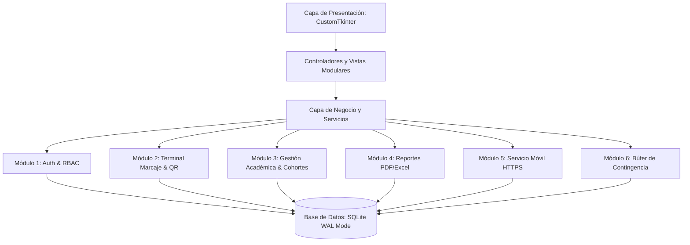
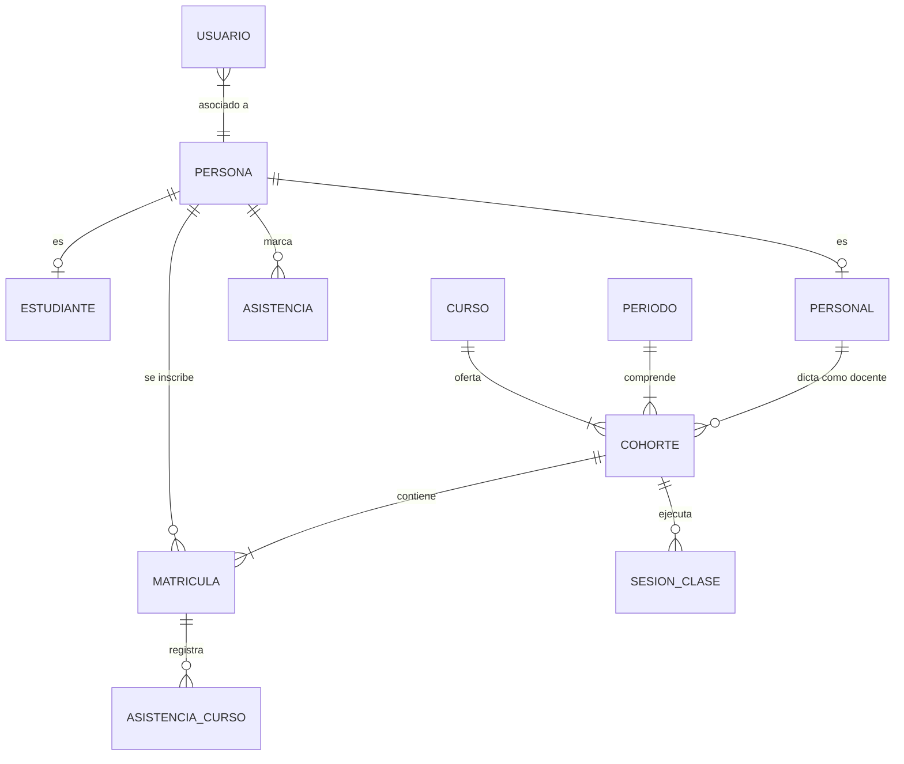

# GUÍA TÉCNICA Y ESTRUCTURAL PARA LA DEFENSA DE GRADO: SISTEMA ASISTA
**Institución:** U.E.P. Prof. Aristóbulo Istúriz (Cabimas, Edo. Zulia)  
**Proyecto:** Sistema Automatizado de Registro, Control y Gestión de Asistencias (ASISTA)

---

## 1. INTRODUCCIÓN Y JUSTIFICACIÓN DEL SISTEMA

### Problema que resuelve
En instituciones educativas, el pase de lista manual en papel o en hojas de cálculo aisladas presenta:
- Pérdida de tiempo en horas de clase.
- Vulnerabilidad ante alteraciones y extravíos de hojas de asistencia.
- Imposibilidad de generar estadísticas y reportes consolidados en tiempo real.
- Falta de un protocolo claro para justificaciones, retrasos y cierres de mes.

### Solución aportada por ASISTA
Una solución integral de software de escritorio y servicio web local autónomo, desarrollada bajo arquitectura modular, que centraliza el marcaje digital (vía código QR y cédula), la gestión por cohortes/turnos y la reportería automatizada tanto en PDF como en Excel, funcionando de manera **100% portable y autónoma** con motor SQLite.

---

## 2. ARQUITECTURA DEL SISTEMA POR MÓDULOS

El sistema está concebido bajo una arquitectura modular desacoplada:

### Módulo 1: Autenticación, Auditoría y Control de Acceso (RBAC)
- **Función:** Regula el acceso al sistema mediante control de roles estricto (*Role-Based Access Control*).
- **Componentes:**
  - `login.py`: Interfaz visual de autenticación, bloqueo temporal tras intentos fallidos y control de sesión activa.
  - Roles definidos: **Directora** (superusuario institucional / dueña con auditoría completa), **Administración** (gestión de personas, cursos y reportes), **Recepción** (operación exclusiva de terminal de marcaje) y **Docentes** (asistencia por curso).
  - Bitácora inmutable: Cada inicio de sesión y acción sensible queda registrada con marca temporal (`auditoria_ingresos` y `bitacora_asistencia`).

### Módulo 2: Terminal de Marcaje, Kiosco y Escáner QR
- **Función:** Registro inmediato de entradas y salidas institucionales.
- **Componentes:**
  - `views/vista_marcaje.py` y `views/vista_kiosco.py`: Modos de pantalla completa y terminal interactiva.
  - Escaneo de carnets QR mediante cámara web usando OpenCV (`cv2`) y decodificación en tiempo real.
  - Soporte de entrada manual por número de Cédula de Identidad para contingencias.
  - Sistema de avisos visuales (verde para asistencia a tiempo, amarillo para retraso, rojo para horario cerrado o no registrado).

### Módulo 3: Gestión Académica, Cursos, Cohortes y Matrículas
- **Función:** Administración de la estructura formativa y el alumnado.
- **Componentes:**
  - `views/vista_personas.py` y `views/vista_admin.py`:
  - CRUD completo de Estudiantes, Docentes y Personal Administrativo/Obrero.
  - Manejo de periodos académicos (trimestrales), cursos y cohortes horarias (mañana/tarde, días específicos).
  - Matrículas activas, cálculo automático del porcentaje de asistencia del estudiante respecto al total de clases programadas.

### Módulo 4: Generación de Reportes y Estadísticas
- **Función:** Procesamiento de datos en documentos formales impresos y descargables.
- **Componentes:**
  - `reports.py` (PDF con ReportLab): Carnets institucionales vectoriales con QR, actas oficiales de asistencia, historiales individuales y resumen diario.
  - `excel_reports.py` (Hojas de cálculo con OpenPyXL): Nóminas consolidadas, matrices mensuales con fórmulas de porcentaje y formatos condicionales.
  - `graficos_utils.py`: Gráficos estadísticos de tendencias de puntualidad y ausentismo.

### Módulo 5: Servicio Autónomo de Asistencia Móvil (Portal Docente)
- **Función:** Servidor HTTP/HTTPS local (`servicio_asista.py`) embebido en segundo plano.
- **Componentes:**
  - Permite a los profesores conectarse desde sus teléfonos móviles o tablets conectadas al WiFi de la institución sin instalar nada en sus celulares.
  - Interfaz web responsiva con escáner de cámara desde el navegador para pasar asistencia en el aula.

### Módulo 6: Búfer Local de Contingencia
- **Función:** Protección contra cortes eléctricos o fallas en el almacenamiento principal.
- **Componentes:**
  - `contingencia.py`: Si el sistema detecta indisponibilidad o bloqueo temporal, almacena las marcas en una base de datos local ligera (`contingencia_local.db`) y las sincroniza automáticamente cuando el sistema principal queda disponible.

---

## 3. REPORTES DEL SISTEMA

Los evaluadores prestarán especial atención a la reportería formal:

| Tipo | Archivo / Motor | Contenido y Utilidad para la Institución |
| :--- | :--- | :--- |
| **Carnets Institucionales con QR** | `carnets.py` / ReportLab | Formato estándar de carnet con foto, datos de la persona, escudo de la institución y código QR encriptado para marcaje rápido. |
| **Acta de Asistencia Diaria** | `reports.py` / ReportLab | Reporte imprimible con firmas de entrega/recepción, listando quién llegó puntual, quién con retraso y ausencias del día. |
| **Historial Individual por Cédula** | `reports.py` / ReportLab | Expediente del estudiante o empleado con el detalle cronológico de asistencias, justificaciones y porcentaje de cumplimiento. |
| **Matriz Mensual en Excel** | `excel_reports.py` / OpenPyXL | Cuadrícula con los 30/31 días del mes, código de colores (P: Presente, R: Retraso, J: Justificado, A: Ausente), totalizador y fórmula de porcentaje. |
| **Informe Estadístico Semestral** | `reports.py` / Matplotlib | Gráficos de barras y tortas para la directiva: comparación de ausentismo por turno, cursos con mayor asistencia y picos horarios. |

---

## 4. BASE DE DATOS Y DIAGRAMAS

### Esquema Relacional Normalizado (Tercera Forma Normal - 3FN)
La base de datos cuenta con **18 tablas principales** optimizadas para integridad referencial:

1. `persona`: Entidad base general (cédula, nombres, teléfono, tipo, foto).
2. `estudiante`: Especialización de persona (representante, teléfono de contacto, sección).
3. `personal`: Especialización de persona (cargo, departamento, tipo de personal).
4. `seccion`: Niveles y secciones con sus respectivos turnos.
5. `periodo`: Ciclos trimestrales/semestrales institucionales.
6. `curso`: Catálogo de especialidades o materias.
7. `cohorte`: Instancia de curso en un periodo, con horario, aula y docente asignado.
8. `matricula`: Relación estudiante-cohorte con seguimiento de porcentaje de asistencia.
9. `asistencia`: Marcajes de entrada y salida institucionales generales.
10. `asistencia_curso`: Marcajes específicos por clase académica.
11. `sesion_clase`: Registro de la sesión impartida por el profesor con firma digital.
12. `usuario`: Cuentas con contraseñas encriptadas y asignación de rol.
13. `configuracion_institucional`: Horarios de apertura, cierre y tiempos de tolerancia.
14. `bitacora_asistencia` y `auditoria_ingresos`: Tablas de seguridad y trazabilidad.

---

## 5. PROTOTIPOS DE PROTOCOLO OPERATIVO

En la defensa, un protocolo es la **secuencia estandarizada de pasos** que el sistema impone:

### Protocolo 1: Marcaje y Reglas Horarias
1. El usuario presenta su código QR o tipea su Cédula.
2. El sistema consulta `configuracion_institucional` para conocer la hora de entrada y la **tolerancia** (ej: 15 minutos).
3. Clasificación automática:
   - Llegada antes o dentro de la tolerancia: Estado **Presente**.
   - Llegada tras vencer la tolerancia: Estado **Retraso**.
   - Si no marcó durante el rango del turno: Se marca automáticamente **Ausente** al cierre.

### Protocolo 2: Justificaciones y Permisos
1. Estudiante o trabajador consigna constancia médica o laboral ante la Administración.
2. El administrador busca la fecha de la falta en el módulo de justificaciones.
3. Se selecciona el tipo de justificación y se adjunta la observación legal.
4. El sistema recalcula en tiempo real el porcentaje de asistencia, excluyendo la penalización.

### Protocolo 3: Auto-Cierre Diario (11:59 PM)
- Un subproceso en segundo plano verifica a las 11:59 PM si quedaron asistencias abiertas.
- Cierra la jornada, genera el acta diaria de incidencias y actualiza la tabla de métricas `cierre_diario`.

---

## 6. SEGURIDAD DEL SISTEMA

| Factor de Seguridad | Implementación en ASISTA | Importancia para la Defensa |
| :--- | :--- | :--- |
| **Cifrado de Credenciales** | Algoritmo **bcrypt** con salting aleatorio. | Las contraseñas nunca se guardan en texto plano. Ni el administrador de la base de datos puede ver las claves reales. |
| **Prevención de Inyecciones SQL** | Consultas parametrizadas con placeholders (`?`) y capas de proxy. | Protege los datos contra ataques de manipulación de entradas de texto en formularios y escáner. |
| **Trazabilidad y Auditoría** | Bitácora inmutable con IP, usuario, acción y marca de tiempo. | Cumple con el principio de no repudio: cualquier modificación o marcaje manual queda auditado. |
| **Comunicaciones Seguras** | HTTPS con certificados SSL/TLS para el portal móvil docente. | Los datos transmitidos entre los celulares de los docentes y la laptop de la institución van encriptados en el WiFi. |
| **Integridad Referencial** | `PRAGMA foreign_keys = ON` en SQLite. | Imposibilita la existencia de registros huérfanos (por ejemplo, asistencias sin estudiante asociado). |

---

## 7. ACERCA DEL CÓDIGO Y DE LA INGENIERÍA DE SOFTWARE

- **Lenguaje:** Python 3.10+ (sintaxis clara, multiplataforma y robusta).
- **Interfaz Gráfica:** CustomTkinter (librería moderna con renderizado acelerado, widgets adaptativos y soporte de Modo Oscuro/Claro).
- **Motor de Base de Datos:** **SQLite 3 con WAL Mode (Write-Ahead Logging)**:
  - Permite lecturas y escrituras simultáneas y de alto rendimiento.
  - Elimina la necesidad de servidores pesados en segundo plano como MySQL o XAMPP.
  - Totalmente portable: la base de datos viaja integrada en un solo archivo (`asista.sqlite`).
- **Patrón de Arquitectura:** Capas desacopladas (Vistas, Modelos/Servicios y Base de Datos) garantizando mantenibilidad y escalabilidad.

---

## 8. PARTE ADMINISTRATIVA (GESTIÓN INSTITUCIONAL)

Para la directiva del plantel, ASISTA provee:
1. **Configuración Flexible de Parámetros:** La directora puede cambiar la hora de inicio de turno, el tiempo de tolerancia y los nombres de las autoridades institucionales sin tocar una sola línea de código.
2. **Expediente Único por Persona:** Un estudiante o profesor cuenta con su historial histórico centralizado desde su primer curso hasta su egreso.
3. **Respaldo de Información en 1 Clic:** Desde la pestaña de administración, el sistema genera copias de seguridad de la base de datos descargables en formato `.sql` o `.sqlite`.
